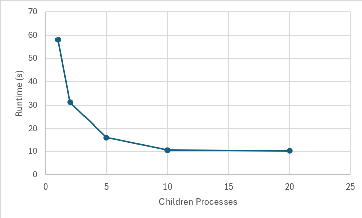

# Lab11_Multiprocessing

## Overview

`mandelmovie` uses `getopt` to read the number of child processes (`-n`), then runs the provided `mandel` program 50 times with `fork()` and `execl()`, shrinking the scale each frame to zoom into the Mandelbrot set. The parent never lets more than `n` children run at once, waits for all of them to finish, and the 50 frames are combined into a movie with `ffmpeg`

Usage:
time ./mandelmovie -n N

